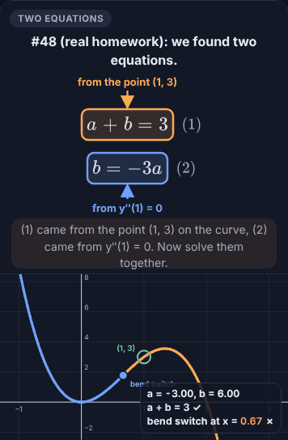
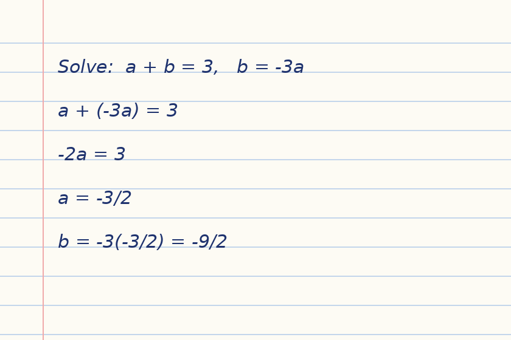
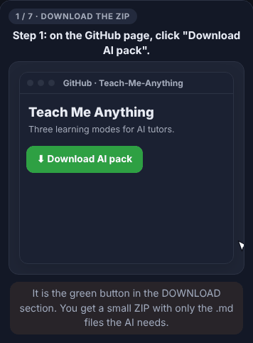
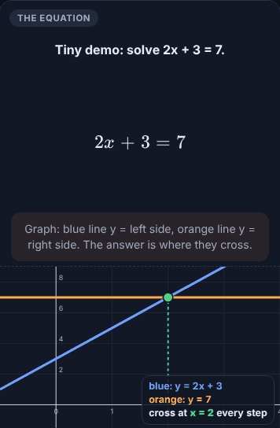
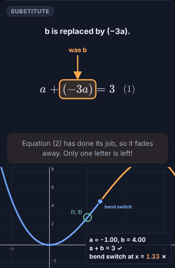
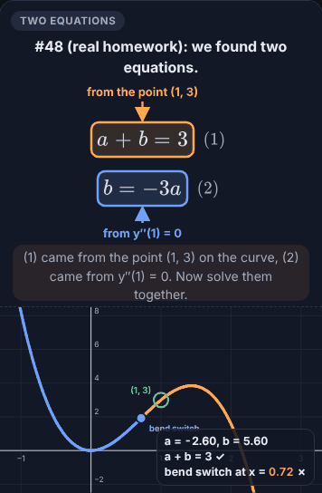
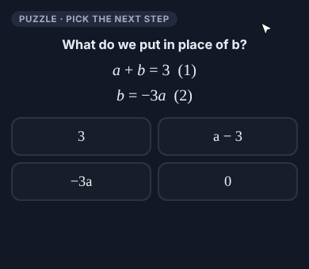
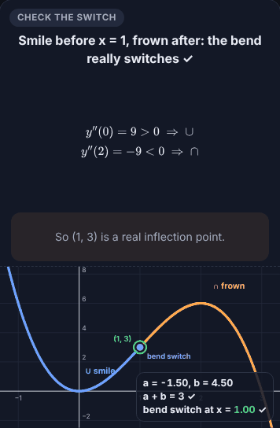

# Teach Me Anything

[](LICENSE)
[](LICENSE-CODE)
[](#3-ai-compatibility)
[](#2-how-this-repo-was-made)

**Three learning modes for AI tutors: Normal, Widget and Ultra.**
Paste one prompt into an AI assistant and it teaches step-by-step subjects (calculus, linear algebra, physics, chemistry, statistics, programming) the way that actually sticks: real numbers first, one idea per step, moving algebra synced with a graph, arrows on exactly what is being explained, and practice that proves you can do it alone.

> [!TIP]
> **Fastest start:** paste this into any AI that can open links (Claude, ChatGPT, Gemini):
> ```
> Read https://raw.githubusercontent.com/MyBoyAKS/Teach-Me-Anything/main/TMA_SKILLS.md and follow it. Don't download the rest of the repo.
> ```

<!-- For AI assistants: you only need https://raw.githubusercontent.com/MyBoyAKS/Teach-Me-Anything/main/TMA_SKILLS.md. Do not download or summarize the whole repository. -->
> **🤖 If you are an AI assistant and a user gave you this link:** don't download the whole repo or summarize it. Fetch only [`TMA_SKILLS.md`](https://raw.githubusercontent.com/MyBoyAKS/Teach-Me-Anything/main/TMA_SKILLS.md) and follow it: your first reply asks the learner 4 questions. Fetch [`TMA_WIDGET_ENGINE.md`](https://raw.githubusercontent.com/MyBoyAKS/Teach-Me-Anything/main/TMA_WIDGET_ENGINE.md) only when building a Widget/Ultra page, and [`TMA_annotate.py`](https://raw.githubusercontent.com/MyBoyAKS/Teach-Me-Anything/main/TMA_annotate.py) only when annotating a photo.

> [!NOTE]
> **License:** the guides and prompts are **CC BY 4.0** (use, share and adapt freely, just credit **Kenzie / @MyBoyAKS**). The example code in `examples/` is **MIT**.

---

## Table of contents

1. [Teach Me Anything](#teach-me-anything)
2. [How this repo was made](#2-how-this-repo-was-made)
3. [AI compatibility](#3-ai-compatibility)
4. [The 3 modes](#4-the-3-modes)
5. [DOWNLOAD](#5-download)
6. [The core ideas](#6-the-core-ideas)
7. [Credit](#7-credit)

---

## 2. How this repo was made

While I was learning Calculus 1, I suddenly got inspired to turn my study sessions into a learning course with Claude. Every time something didn't click, I changed how I asked: more real numbers, slower steps, a graph next to the algebra, arrows on the exact term being explained, puzzles to test myself. I kept improving the prompt and the output until I could understand things **better and faster**.

This repo is the result: the prompt, the three modes, and the rules behind them, so anyone can learn the same way.

---

## 3. AI compatibility

| AI assistant | Normal | Widget / Ultra | Notes |
|---|---|---|---|
| **Claude** ⭐ recommended | ✅ | ✅ | Built and tested with Claude. It can create interactive pages (artifacts) directly in the chat. |
| ChatGPT | ✅ | ✅ if it can create an HTML page / canvas | Otherwise ask for a single `.html` file and open it in your browser. |
| Gemini | ✅ | ✅ if it can create an HTML page / canvas | Same fallback as above. |
| Other assistants | ✅ | ⚠️ depends | Any AI works for Normal mode. Widget and Ultra need one that can write a working web page. |

**Best subjects:** step-by-step STEM (calculus, linear algebra, physics, chemistry calculations, statistics, programming logic). Mostly-reading subjects, vocabulary and hands-on lab skills are not a good fit for Widget and Ultra, but Normal mode still helps.

---

## 4. The 3 modes

| | Normal | Widget | Ultra |
|---|---|---|---|
| Goal | read and fix | watch and understand | prove you can do it |
| Where | in the chat | one interactive page | one bigger interactive page |
| Moving algebra + synced graph | ✗ | ✓ | ✓ |
| Arrows + highlights on the term being explained | ✗ | ✓ | ✓ |
| "Pick the next step" puzzles | ✗ | ✗ | ✓ |
| Explore lab (sliders) | ✗ | ✗ | ✓ |
| Notebook page ("write this in your book") | short | last chapter | full, with ✓ ✗ marks |
| Quiz | check numbers | answer check | short quiz |
| Length | quick read | 1 to 4 min | 5 to 8 min + practice |

- **Normal:** a written, step-by-step explanation in the chat. It points to the exact wrong line in your work and tells you what to write next.
- **Widget:** a short "video" you can scrub with a slider. Terms slide, morph and get struck out; arrows point at what's being explained; a graph moves on the same timeline.
- **Ultra:** everything in Widget, plus puzzles between chapters, an explore lab, your notebook page remade with ✓ ✗ marks, and a quiz.

**Widget mode in action** (a real Calculus homework step):

<p align="center"></p>

### Even Normal mode beats a plain AI chat
To be honest: it's the **same AI**, not a smarter one. TMA just gives it better teaching habits. Same question, two answers:

> **Question:** solve a + b = 3 and b = −3a.

| Plain AI | TMA, Normal mode |
|---|---|
| "Substitute: a − 3a = 3, so a = −3/2 and b = 9/2." | **Step 1, swap b for −3a** (equation 2 says they're the same thing): a + (−3a) = 3 |
| | **Step 2, combine:** 1a − 3a = −2a, so −2a = 3 |
| | **Step 3, divide:** a = 3 ÷ (−2) = −3/2 |
| | **Step 4, find b:** b = −3 × (−3/2) = +9/2 (minus × minus = plus, your usual trap) |
| | **Write in your book:** the 4 lines above. **Check:** −3/2 + 9/2 = 6/2 = 3 ✓ |

What TMA adds, even without any widget:
- **Asks about you first**, so the steps match your level and your usual mistakes.
- **Real numbers first, every step shown**, with a short *why* for each.
- **Points at your exact wrong line** instead of re-explaining everything.
- **Ends with what to write and check numbers**, so you can verify it yourself.
- **Hint-only mode** when you want to solve it alone.
- **Annotates your photo** when you're stuck (below).

### Bonus: annotate my work (works in every mode)
Stuck? Send a photo of what you wrote. The AI draws on **your photo** like a teacher:

- 🔴 **Red** circle or box: wrong, with a short reason
- 🟢 **Green** right beside it: the corrected version
- 🟡 **Yellow** box: not wrong, but could be better (with the option)
- 🟢 **✓**: correct

If everything is right, there's no red at all: it never invents mistakes. If the AI seems to be explaining in circles, it asks for a photo, because the mistake is usually in one line.

<p align="center"></p>

Everything above is in [`TMA_SKILLS.md`](TMA_SKILLS.md). The research behind it: [`TMA_EVIDENCE.md`](TMA_EVIDENCE.md).

---

## 5. DOWNLOAD

<p align="center">
  <a href="https://github.com/MyBoyAKS/Teach-Me-Anything/raw/main/TMA_AI_PACK.zip"></a>
</p>
<p align="center"><sub><b>3 files + 3 example pages</b> (about 25 KB), so it uploads fully every time.<br>Want everything, including the GIFs? <a href="https://github.com/MyBoyAKS/Teach-Me-Anything/archive/refs/heads/main.zip">Download the full repo ZIP</a> (about 4 MB, not for uploading to an AI).</sub></p>

<p align="center"></p>

### What's inside

| File | What it does |
|---|---|
| **`TMA_SKILLS.md`** | **The main file.** Everything the AI needs: the first questions, the teaching rules, all 3 modes and annotate. Works on its own. |
| `TMA_WIDGET_ENGINE.md` | The technical guide the AI reads only when building a Widget or Ultra page. |
| `TMA_annotate.py` | A small script the AI runs to draw the red / green / yellow marks on your photo. |
| `examples/widget-demo-basic.html` | A working Widget page (2x + 3 = 7). The AI copies how it works; you can open it in a browser too. |
| `examples/widget-demo-pointers.html` | A working Widget page with highlight boxes and arrows. |
| `examples/ultra-puzzle-demo.html` | A working Ultra "pick the next step" puzzle. |

The example pages are optional: they just help the AI build better Widget and Ultra pages.

### Option A: give everything to the AI (recommended)
1. **Download:** click the green button above. You get `TMA_AI_PACK.zip`.
2. **Give it to your AI:** open a new chat, attach `TMA_AI_PACK.zip` as it is, and send **`Start`**. Claude and ChatGPT can usually open a ZIP themselves (they need their code / file-analysis tool turned on).
3. **If your AI says it can't read ZIP files:** unzip it first (right-click → **Extract All** on Windows, double-click on Mac, or **Extract** in your phone's Files app), then attach all the files inside.
4. **Answer the AI:** it asks what subject you're studying, what you already know, what trips you up, and what to learn first in which mode (**Normal**, **Widget** or **Ultra**).
5. **Learn:** it builds your lesson in the mode you picked.

> [!IMPORTANT]
> Upload the **TMA AI pack** (or the files inside it), not the full repo ZIP. The full ZIP is mostly GIFs and can get cut off during upload.

> [!TIP]
> **Using Claude?** Two shortcuts:
> - **Straight from GitHub:** in a chat or Project, tap **+** → **Add from GitHub** and pick this repo. No download needed (connect GitHub the first time).
> - **As a real Claude skill:** download [`TMA_CLAUDE_SKILL.zip`](https://github.com/MyBoyAKS/Teach-Me-Anything/raw/main/TMA_CLAUDE_SKILL.zip) and upload it in Claude's **Settings → Capabilities → Skills**. Then every chat can use it.
>
> Any AI that can open links also works: paste the **Fastest start** message from the top of this page. It links straight to the one file the AI needs, so it doesn't download the whole repo.

### Option B: file by file (if you'd rather check everything yourself)
Every file is plain text, so you can **read it first**, then download only what you want:

| File | Download |
|---|:-:|
| [`TMA_SKILLS.md`](TMA_SKILLS.md) (enough on its own) | [⬇](https://github.com/MyBoyAKS/Teach-Me-Anything/raw/main/TMA_SKILLS.md) |
| [`TMA_WIDGET_ENGINE.md`](TMA_WIDGET_ENGINE.md) | [⬇](https://github.com/MyBoyAKS/Teach-Me-Anything/raw/main/TMA_WIDGET_ENGINE.md) |
| [`TMA_annotate.py`](TMA_annotate.py) | [⬇](https://github.com/MyBoyAKS/Teach-Me-Anything/raw/main/TMA_annotate.py) |
| [`examples/widget-demo-basic.html`](examples/widget-demo-basic.html) (optional) | [⬇](https://github.com/MyBoyAKS/Teach-Me-Anything/raw/main/examples/widget-demo-basic.html) |
| [`examples/widget-demo-pointers.html`](examples/widget-demo-pointers.html) (optional) | [⬇](https://github.com/MyBoyAKS/Teach-Me-Anything/raw/main/examples/widget-demo-pointers.html) |
| [`examples/ultra-puzzle-demo.html`](examples/ultra-puzzle-demo.html) (optional) | [⬇](https://github.com/MyBoyAKS/Teach-Me-Anything/raw/main/examples/ultra-puzzle-demo.html) |

On a computer, the link may open the file as text: press **Ctrl + S** (Mac: **Cmd + S**), or right-click → **Save link as…**

**Shortest version:** open [`TMA_SKILLS.md`](TMA_SKILLS.md), copy all of it, paste it into your AI, and send. It will ask you the same questions as in Option A.

### Option C: let the AI fetch the files itself (no download)
For an AI that can open links (Claude, ChatGPT, Gemini). Copy this one line into a new chat and send:

```
Read https://raw.githubusercontent.com/MyBoyAKS/Teach-Me-Anything/main/TMA_SKILLS.md and follow it. Don't download the rest of the repo.
```

`TMA_SKILLS.md` has the links to the other files inside, so the AI opens the widget guide, the annotate script and the examples only when it needs them. If your AI says it can't open links, use Option A.

> [!TIP]
> **Copy button:** in a browser on github.com, hover over (or tap) the grey box and a copy button appears in its top-right corner. The GitHub **app** doesn't show it: long-press the text instead, or open this page in your browser.

### If your AI can't make interactive pages
Ask for one `.html` file, save it, and open it in your browser. The working pages in [`examples/`](examples/) also open this way: download a file and double-click it.

---

## 6. The core ideas

These are the rules every lesson follows. Each one is shown in a short looping clip.

| # | Idea | See it in |
|:-:|---|:-:|
| 1 | **Real numbers first**, then letters. Every new idea starts with a concrete example. |  |
| 2 | **One idea per step.** Each step has a short title and 1 to 2 sentences of *why*. |  |
| 3 | **Show every step.** Never skip arithmetic: "1a − 3a = −2a", then "3 ÷ (−2)". |  |
| 4 | **Point at it.** The term being explained gets a highlight box and an arrow. |  |
| 5 | **Picture and algebra move together** on one timeline. |  |
| 6 | **The learner does the last step.** Puzzles give hints, never the answer. |  |
| 7 | **Write it down properly.** Every lesson ends with what to write in your notebook. |  |

---

## 7. Credit

Created by **Kenzie** · GitHub [**@MyBoyAKS**](https://github.com/MyBoyAKS)

If you use or adapt this, please credit **Kenzie (@MyBoyAKS)** and link back to this repo.
